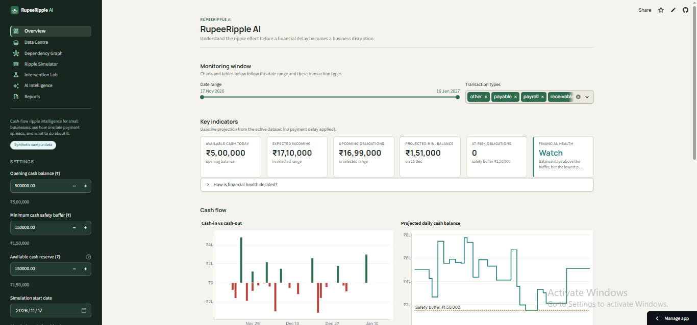
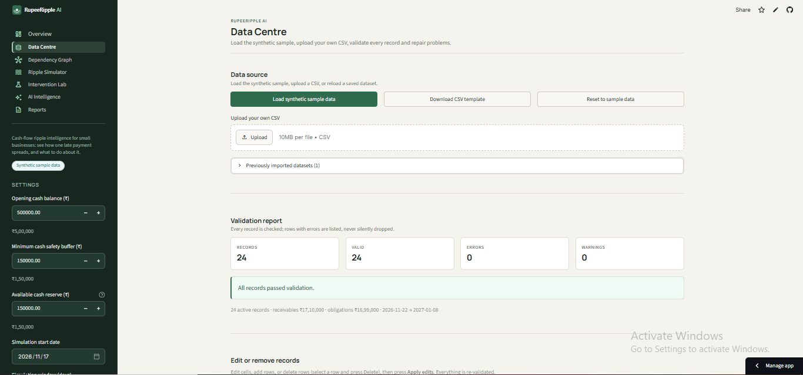
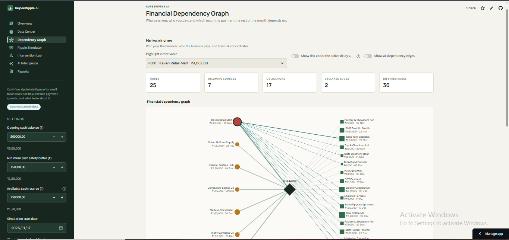
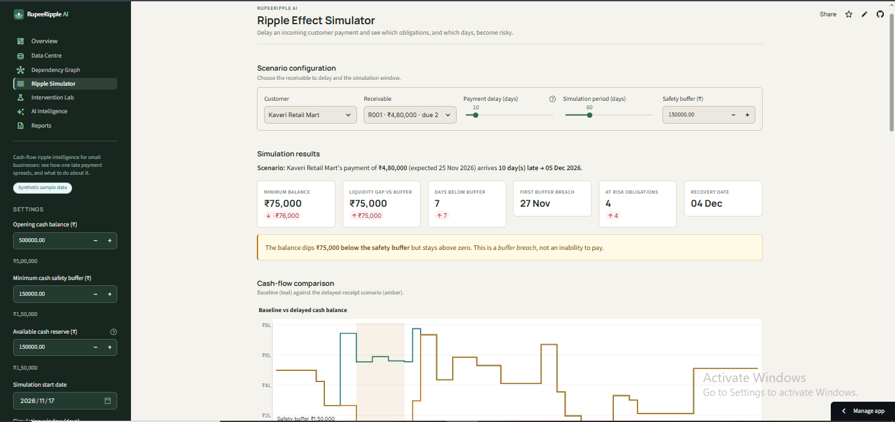
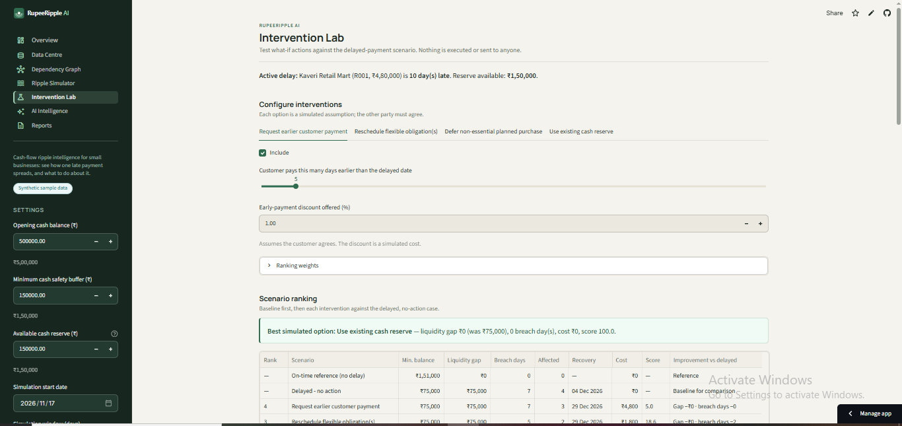
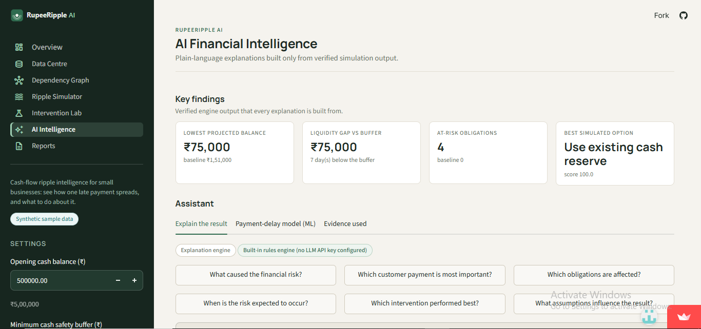
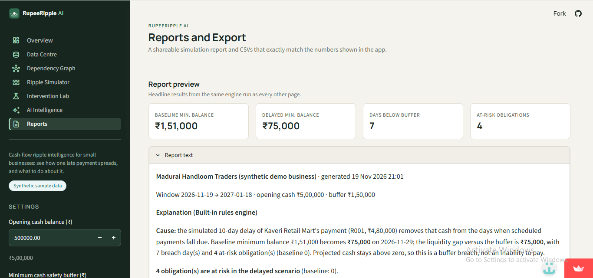

# 💧 RupeeRipple AI

**Understand the ripple effect before a financial delay becomes a business disruption.**

Financial Shock Propagation and Decision Intelligence for Small Businesses

🚀 **Live Application:** [Launch RupeeRipple AI](https://rupeeripple-ai-smtf4q9589e79xtakfstfv.streamlit.app/)

🎥 **Project Demo Video:** [Watch RupeeRipple AI Demo](https://youtu.be/R0ZixtZ5Juk)

Developed for Arthaton 2026.

RupeeRipple AI is a decision-support and simulation app for India's small businesses. It builds a time-dependent
financial dependency graph, simulates a delayed customer payment, shows which obligations and which days become risky,
compares interventions, and explains the result in plain language. It never moves money or contacts anyone.

> All demo data is **synthetic** (a fictional handloom business). Outputs are simulations, **not financial advice**.

## Problem
Small businesses fund suppliers, salaries, rent and utilities from customer receipts. A cash balance alone does not show
how *one* late payment spreads through later obligations.

## Solution and differentiation
1. **Dependency graph + criticality score** – which incoming payment does the rest of the month depend on?
2. **Ripple simulator** – delay it by N days; see baseline vs delayed cash, breach days, liquidity gap, affected obligations.
3. **Intervention Lab** – earlier payment, rescheduling flexible bills, deferring purchases, using a reserve; ranked transparently.
4. **Two-layer AI** – Python computes every number; an optional LLM may only rephrase verified evidence. Works with no API key.
5. **Honest semantics** – a projected *buffer breach* is not a *default*; "cannot be covered" only appears when projected cash < 0.

## Features (all implemented)
Overview dashboard · Data Centre (sample / upload / validate / edit / template / reset) · Dependency Graph ·
Ripple Simulator · Intervention Lab · AI Financial Intelligence (chat + ML payment-delay model) · Reports (PDF + 4 CSVs) ·
SQLite persistence · 32 automated tests.

## Design system
Light, warm-neutral workspace with a deep forest-green sidebar. Styling lives in `core/ui.py` (CSS tokens, KPI cards, section headings, sidebar, `styled()` table helper), `core/charts.py` (Plotly palette, Indian-unit axes) and `.streamlit/config.toml` (theme). Inter and Manrope are **bundled** in `static/fonts/` (SIL Open Font License) and served by Streamlit static serving, so the app looks the same offline. Rupee amounts use Indian digit grouping (₹4,80,000) in cards, tables and hovers; chart axes use ₹50k / ₹2L / ₹1Cr. The layout reflows on tablet and phone widths. Logos are in `assets/`.

## Architecture
```
app.py                    Overview dashboard (entry point)
pages/1..6_*.py           Data Centre, Dependency Graph, Ripple Simulator, Intervention Lab, AI Intelligence, Reports
core/validation.py        CSV schema + row validation (nothing silently dropped)
core/ripple_engine.py     Deterministic cash-flow simulation  (Layer A)
core/dependency_engine.py NetworkX graph + criticality scoring
core/intervention_engine.py  Counterfactual scenarios + ranking
core/pipeline.py          One entry point so every page uses the same engine run
core/ai_explainer.py      Evidence builder, rules explanations, optional LLM (Layer B) + number check
core/prediction_model.py  Optional scikit-learn late-payment model (never used by the simulator)
core/report.py            Report content, CSV exports, PDF (reportlab)
core/database.py          SQLite (datasets, settings, simulations, scenarios, reports) - idempotent inserts
core/state.py, ui.py, charts.py   Shared session state, theme/sidebar, Plotly figures
tests/                    pytest suite
data/sample_data.csv      Synthetic business; dates shift so day 0 = today
```
Validation uses plain, explicit Python (no Pydantic) so every failure becomes a readable row in the issues table.

## Data schema
`transaction_id, entity_name, entity_type, transaction_type, amount, due_date, expected_date, status, related_entity, flexibility`

| Column | Allowed values / meaning |
|---|---|
| entity_type | customer, supplier, employee, landlord, utility, government, other |
| transaction_type | **receivable** (cash in); payable, payroll, rent, utilities, other (cash out) |
| amount | > 0 (zero/negative rejected) |
| due_date / expected_date | YYYY-MM-DD. Blank expected_date → due_date (warning). For *paid* receivables, expected_date = actual payment date (used for ML history) |
| status | pending, overdue, paid (paid rows assumed already in opening cash) |
| related_entity | optional link; creates a *declared* graph edge |
| flexibility | fixed or flexible |

Settings (sidebar): opening cash, safety buffer, cash reserve, start date, window length, criticality weights.

## Simulation rules (assumptions are also shown in the UI)
- Receipts arrive on `expected_date` + delay; payments are made on `due_date` (+ any approved deferral). Never earlier.
- Items dated before the start date are projected on the start date.
- Same day: receipts first, then payments ordered by due date and ID; balances are end-of-day.
- Payments are assumed made even if cash is short, so balances can go negative (the liquidity gap).
- Buffer breach day = end-of-day balance < buffer. Liquidity gap = buffer − lowest balance. Cash shortfall = amount below zero.
- Same input → same output (no randomness in the engine).

## Install and run (Windows, PowerShell)
```powershell
cd rupeeripple-ai
py -m venv .venv
.venv\Scripts\Activate.ps1          # if blocked: Set-ExecutionPolicy -Scope Process Bypass
pip install -r requirements.txt
streamlit run app.py
```
macOS/Linux: `python3 -m venv .venv && source .venv/bin/activate && pip install -r requirements.txt && streamlit run app.py`.

**Load sample data:** it loads automatically on first launch. Anytime: *Data Centre → Load synthetic sample data / Reset to sample data*.

**Run tests:** `python -m pytest -q`

## AI model / API
- Default: built-in rules engine (no key, no network). Each answer is labelled with its source.
- Optional LLM: set `ANTHROPIC_API_KEY` (env var or `.streamlit/secrets.toml`) and optionally `RUPEERIPPLE_LLM_MODEL`.
  The LLM receives only the structured evidence JSON, is told not to invent figures, and any 4+ digit figure in its reply that is not in the evidence is flagged. On any failure the rules-engine answer is shown.
- ML (scikit-learn): logistic regression + ridge on per-customer history features computed from *earlier* invoices only, chronological 75/25 split, compared with baselines. Uses your paid receivables if you have ≥ 60, otherwise the bundled **synthetic** history (labelled). Metrics shown are computed live, not hard-coded.

## Limitations
- Deterministic what-if engine; real customers, suppliers and banks behave less predictably.
- Dependency edges marked *inferred* come from a liquidity test (what gets riskier if a receipt never arrives), not contracts.
- Interventions assume the other party agrees; nothing is executed. Fees/discounts are user-entered assumptions.
- ML history is synthetic unless you supply ≥ 60 paid receivables; the delay-days regressor may not beat the simple per-customer average (the app says so when that happens).
- The optional LLM path was written and unit-tested with a mock; it has not been exercised against a live API key in development.
- SQLite on free hosting is usually ephemeral; saved data may reset on redeploy.
- The sidebar navigation icons and the "Overview" label are styled through Streamlit's markup, which is why `requirements.txt` caps the Streamlit version. If that markup changes, navigation still works; only the icons/label styling would fall back to plain.
- The visual design was checked in Chromium (desktop, tablet and phone widths). Firefox and Safari were not available to test.

## Deployment (Streamlit Community Cloud)
1. Push this folder to GitHub (`.env`, `secrets.toml` and `*.db` are git-ignored).
2. share.streamlit.io → *New app* → pick the repo, main file `app.py`.
3. Optional: *Advanced settings → Secrets* → `ANTHROPIC_API_KEY = "..."`.

## Application Screenshots

### 1. Overview Dashboard


### 2. Data Centre


### 3. Dependency Graph


### 4. Ripple Simulator


### 5. Intervention Lab


### 6. AI Financial Intelligence


### 7. Reports


## 5-minute demo script
1. **Overview (0:00)** – "Madurai Handloom Traders, synthetic data. Healthy on paper, but headroom is thin: **Watch**, lowest balance ₹1,51,000 vs ₹1,50,000 buffer."
2. **Dependency Graph (0:45)** – Kaveri Retail Mart's ₹4,80,000 is **High** criticality (≈88/100). Select it: dotted cyan lines = obligations that would get riskier (inferred); solid line to Warp Yarn = declared in data.
3. **Ripple Simulator (1:30)** – Customer *Kaveri Retail Mart*, receivable R001, delay **10 days**.
4. Show the metric strip: lowest balance ₹75,000, gap ₹75,000, 7 breach days, 4 at-risk obligations, first breach on day 10 of the window (sample dates shift so day 0 = today).
5. Point out the amber banner: *buffer breach, not inability to pay* (cash stays above zero).
6. Highlighted obligations in the graph and the at-risk table (Warp Yarn, Dye & Chemicals, electricity, broadband).
7. **Intervention Lab (3:00)** – compare scenarios: reserve (gap → 0), reschedule flexible bills (5 breach days, 2 affected), earlier payment, defer purchase (no help – the purchase falls after the breach). Mention costs and that suppliers must agree.
8. Side-by-side balance chart for *Delayed – no action* vs the best option.
9. **AI Financial Intelligence (3:45)** – click "What caused the financial risk?" then "Which intervention performed best?"; note the badge: rules engine, no API key needed. Show the *Evidence used* tab.
10. Optional: ML tab – late-payment probabilities, metrics vs baselines, honest limitations.
11. **Reports (4:30)** – download the PDF and the CSVs; values match the screens.
